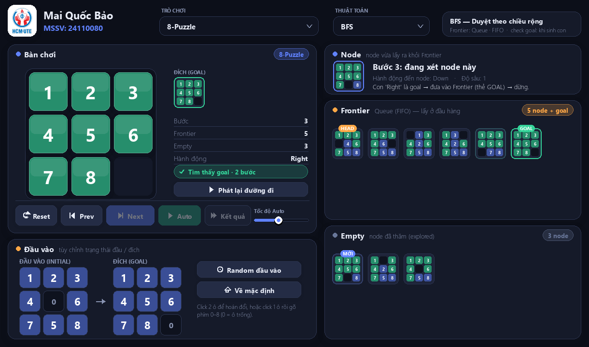
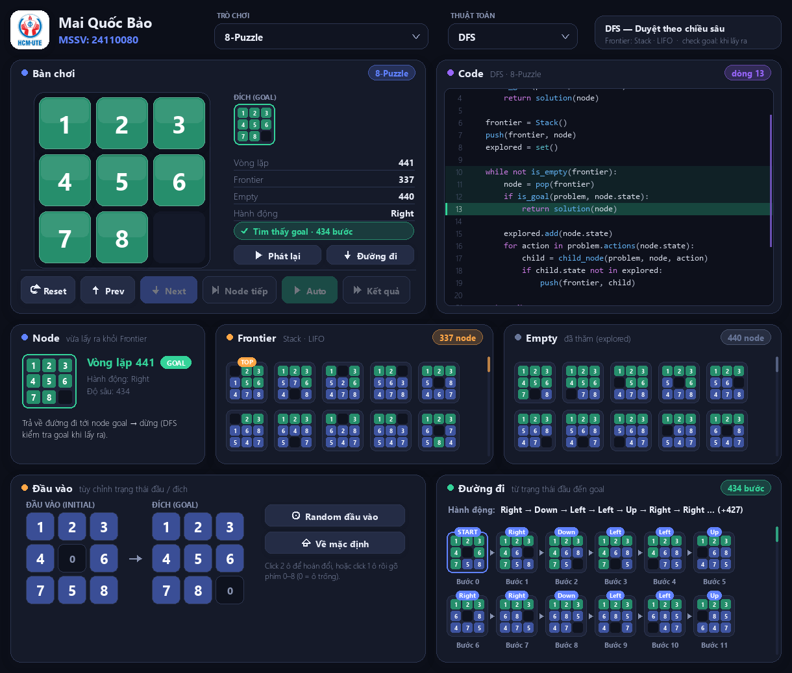

# Search Visualizer — BFS & DFS trên 8-Puzzle và Vacuum Robot

Ứng dụng **Python + Pygame** minh họa từng bước hai thuật toán tìm kiếm **BFS** và **DFS** trên hai bài toán **8-Puzzle** và **Vacuum Robot**. Mỗi lần bấm *Next*, thuật toán chạy đúng **một dòng code**: bảng **Code** highlight dòng đó, các bảng Node, Frontier (Queue/Stack), Empty cập nhật ngay theo dòng vừa chạy (`dequeue`, `explored.add`, `enqueue`…). Nút *Node tiếp* chạy hết cả vòng lặp để xét xong một node. Khi tìm thấy goal, bảng **Đường đi** hiện toàn bộ đường đi từ đầu đến goal.

> **Sinh viên:** Mai Quốc Bảo · **MSSV:** 24110080 · HCM-UTE



## Tính năng

- **Chọn trò chơi và thuật toán** bằng dropdown: 8-Puzzle / Vacuum Robot, BFS / DFS.
- **Điều khiển từng bước**:
  - `Next` / `Prev`: chạy tới / lùi lại **1 dòng code**.
  - `Node tiếp`: chạy hết vòng lặp hiện tại (xét xong 1 node), highlight lướt qua các dòng còn lại.
  - `Auto`: tự bấm Next liên tục, thanh trượt chỉnh 1–240 dòng/giây.
  - `Kết quả`: chạy nhanh đến khi tìm thấy goal, bấm lần nữa để dừng.
  - `Reset`.
- **Bảng Code**: hiện code BFS/DFS giống notebook, kèm phần khởi tạo `Problem(...)` tương ứng với trò đang chọn (`actions_puzzle`/`result_puzzle` hoặc `actions_vacuum`/`result_vacuum`, trạng thái đầu và goal theo đầu vào hiện tại).
  - Mỗi lần *Next*, highlight chuyển sang dòng kế tiếp của vòng lặp (`while` → `pop`/`dequeue` → `for` → `if` → `push`/`enqueue` …), kèm giá trị như `action = 'Up'`, `True`/`False`. Bảng Node giải thích dòng vừa chạy.
  - Dòng đang chạy luôn được cuộn vào tầm nhìn; có thể tự cuộn bằng con lăn.
- **Bảng Đường đi**: sau khi tìm thấy goal, hiện chuỗi hành động (`Down → Right`) và từng trạng thái từ *Bước 0* đến *GOAL*, cuộn được khi đường đi dài. Đường đi cũng được in ra terminal giống output của notebook (`Step 0:`, `Step 1:` …).
- **Ba bảng trạng thái**:
  - **Node**: node vừa được lấy ra khỏi Frontier, kèm một câu giải thích dòng code vừa chạy.
  - **Frontier**: Queue (FIFO) với BFS, Stack (LIFO) với DFS; có nhãn `HEAD` / `TOP` cho phần tử sắp được lấy ra.
  - **Empty**: các node đã thăm (explored), node mới nhất ở đầu.
- **Animation mượt**: ô số trượt, robot di chuyển giữa hai phòng, bụi mờ dần và có hiệu ứng hút. Thẻ mới sinh hiện dần kèm viền nổi bật.
- **Phát lại đường đi** từ đầu đến goal sau khi tìm thấy lời giải.
- **Tùy chỉnh đầu vào**:
  - 8-Puzzle: chỉnh trạng thái đầu và đích (click 2 ô để hoán đổi, hoặc click 1 ô rồi gõ `0–8`), có nút *Random* và *Về mặc định*. Đầu vào không giải được sẽ bị cảnh báo và khóa nút chạy.
  - Vacuum: đổi Dirty/Clean từng phòng, chọn vị trí xuất phát của robot, chỉnh trạng thái đích.

- **Trang cuộn được**: nếu màn hình không đủ cao, nội dung kéo dài xuống dưới và có thanh cuộn bên phải (kéo thanh cuộn, lăn chuột, hoặc dùng phím ↑ ↓ / PgUp PgDn). Nút *Đường đi* trên bàn chơi cuộn thẳng tới bảng Đường đi.

- **Cửa sổ co giãn được**: kéo giãn cửa sổ thì giao diện tự co/giãn theo chiều rộng. Muốn cửa sổ mặc định nhỏ hơn thì giảm hằng số `UI_SCALE` trong `main.py` (ví dụ `0.85`).

### Bố cục

| Hàng | Bên trái | Bên phải |
|---|---|---|
| 1 | Bàn chơi + nút điều khiển + tốc độ Auto | Code (highlight dòng đang chạy) |
| 2 | Node · Frontier · Empty | |
| 3 | Đầu vào | Đường đi |

## Ảnh chụp ứng dụng

| 8-Puzzle · BFS đang chạy từng dòng (giữa vòng lặp 2) | 8-Puzzle · DFS (đường đi dài, cuộn được) |
|---|---|
|  |  |

| Vacuum Robot · DFS | Dropdown chọn trò chơi |
|---|---|
|  |  |

## Cài đặt và chạy

Yêu cầu: Python 3.9+ (đã thử với 3.11) và `pygame`.

```bash
pip install -r requirements.txt
python main.py
```

### Phím tắt

| Phím | Chức năng |
|---|---|
| `→` / `←` | Next / Prev (1 dòng code) |
| `Shift` + `→` | Node tiếp (chạy hết vòng lặp) |
| `Shift` + `←` | Lùi về đầu vòng lặp (hoặc lùi cả vòng lặp trước) |
| `Space` | Auto / Pause |
| `R` | Reset |
| `Esc` | Đóng dropdown / bỏ chọn ô |
| `↑` `↓` / `PgUp` `PgDn` / `Home` `End` | Cuộn trang |

## Cách hoạt động của hai thuật toán

Logic bám theo hai notebook bài tập (`Problem`, `Node`, `child_node`, `solution`), chỉ khác là thuật toán được tách thành từng dòng để có thể bấm *Next* / *Prev* (mỗi dòng có thể hoàn tác).

| | BFS | DFS |
|---|---|---|
| Frontier | Queue (FIFO) | Stack (LIFO) |
| Kiểm tra goal | Khi **sinh node con** | Khi **lấy node ra** |
| Bỏ qua node con | Đã ở Empty hoặc đã nằm trong Frontier | Chỉ cần đã ở Empty |
| Đường đi | Ngắn nhất | Có thể rất dài, không tối ưu |

Ví dụ với 8-Puzzle `((1,2,3),(4,0,6),(7,5,8))` → `((1,2,3),(4,5,6),(7,8,0))`: BFS tìm ra đường đi 2 nước (`Down`, `Right`) sau 3 vòng lặp, còn DFS đi qua hàng trăm nước vì đào sâu theo một nhánh.

> Ở BFS, khi con của node đang xét là goal, thuật toán dừng ngay. App hiển thị thẻ goal đó ở cuối Frontier (nhãn `GOAL`) để dễ theo dõi, dù trong code gốc nó không được `enqueue`.

## Cấu trúc dự án

```
├── main.py         # vòng lặp pygame, bố cục, xử lý sự kiện
├── algorithms.py   # BFS / DFS chạy từng dòng / từng vòng lặp (tiến/lùi), Problem, Node
├── problems.py     # định nghĩa 8-Puzzle và Vacuum Robot
├── inputs.py       # bảng tùy chỉnh đầu vào
├── codeview.py     # bảng Code: nội dung code theo trò, tô màu cú pháp, highlight dòng đang chạy
├── views.py        # vẽ bàn 8-puzzle, phòng Vacuum, thẻ trạng thái, danh sách cuộn
├── ui.py           # theme, font, widget (Button, Dropdown, Slider, Panel)
├── ute_logo.png    # logo trường
└── screenshots/    # ảnh dùng trong README
```

## Thêm trò chơi hoặc thuật toán mới

Ở đầu `main.py` có hai danh sách `GAMES` và `ALGOS`; thêm một dòng vào đây là dropdown có thêm mục. Để mục mới chạy được còn cần:

- **Thuật toán mới**: thêm xử lý trong `SearchMachine` (`algorithms.py`), và code hiển thị + cách map từng bước sang dòng code trong `codeview.py`. Dòng code nào làm thay đổi Frontier/Empty thì khai báo trong `_TAG_OP` (`algorithms.py`) để Next/Prev theo dòng cập nhật đúng các bảng.
- **Trò chơi mới**: thêm `Problem` (`problems.py`), cách vẽ trạng thái (`views.py`) và bảng nhập đầu vào (`inputs.py`).

## Lưu ý

- DFS trên 8-Puzzle thường cho đường đi rất dài (có thể hàng nghìn nước). *Auto* chạy theo từng dòng code nên khá lâu với bài dài; dùng *Node tiếp* hoặc nút *Kết quả* để xem nhanh.
- BFS với đề rất khó (ví dụ lời giải 31 nước) cần khoảng 10 giây để chạy hết bằng *Kết quả*; app vẫn phản hồi và hiện số bước đang chạy trong lúc đó.
