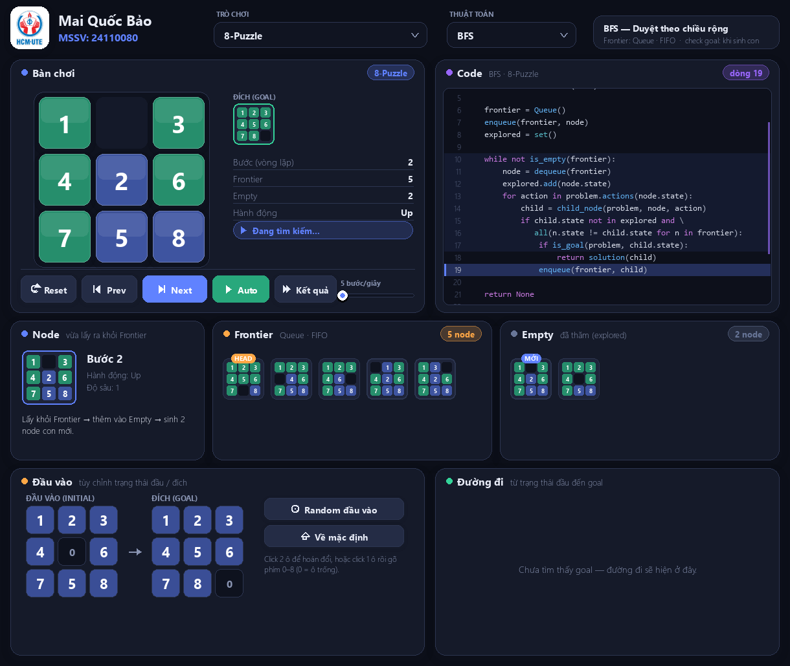

# Search Visualizer — BFS & DFS trên 8-Puzzle và Vacuum Robot

Ứng dụng **Python + Pygame** minh họa từng bước hai thuật toán tìm kiếm **BFS** và **DFS** trên hai bài toán **8-Puzzle** và **Vacuum Robot**. Mỗi lần bấm *Next*, thuật toán chạy đúng một vòng lặp, và giao diện hiển thị rõ node đang xét, Frontier (Queue/Stack) và các node đã thăm.

> **Sinh viên:** Mai Quốc Bảo · **MSSV:** 24110080 · HCM-UTE


## Tính năng

- **Chọn trò chơi và thuật toán** bằng dropdown: 8-Puzzle / Vacuum Robot, BFS / DFS.
- **Điều khiển từng bước**: `Next` (bước tiếp), `Prev` (lùi lại), `Auto` (tự chạy, thanh trượt chỉnh 1–128 bước/giây), `Kết quả` (chạy nhanh đến khi tìm thấy goal), `Reset`.
- **Ba bảng trạng thái**:
  - **Node**: node vừa được lấy ra khỏi Frontier.
  - **Frontier**: Queue (FIFO) với BFS, Stack (LIFO) với DFS; có nhãn `HEAD` / `TOP` cho phần tử sắp được lấy ra.
  - **Empty**: các node đã thăm (explored), node mới nhất ở đầu.
- **Animation mượt**: ô số trượt, robot di chuyển giữa hai phòng, bụi mờ dần và có hiệu ứng hút. Thẻ mới sinh hiện dần kèm viền nổi bật.
- **Phát lại đường đi** từ đầu đến goal sau khi tìm thấy lời giải.
- **Tùy chỉnh đầu vào**:
  - 8-Puzzle: chỉnh trạng thái đầu và đích (click 2 ô để hoán đổi, hoặc click 1 ô rồi gõ `0–8`), có nút *Random* và *Về mặc định*. Đầu vào không giải được sẽ bị cảnh báo và khóa nút chạy.
  - Vacuum: đổi Dirty/Clean từng phòng, chọn vị trí xuất phát của robot, chỉnh trạng thái đích.

## Ảnh chụp ứng dụng

| 8-Puzzle · BFS đang chạy | 8-Puzzle · DFS |
|---|---|
|  |  |

| Vacuum Robot · DFS | Dropdown chọn trò chơi |
|---|---|
|  |  |

## Cài đặt và chạy

Yêu cầu: Python 3.9+ (đã thử với 3.11) và `pygame`.

```bash
pip install -r requirements.txt
python main.py
```

### Phím tắt

| Phím | Chức năng |
|---|---|
| `→` | Next |
| `←` | Prev |
| `Space` | Auto / Pause |
| `R` | Reset |
| `Esc` | Đóng dropdown / bỏ chọn ô |

## Cách hoạt động của hai thuật toán

Logic bám theo hai notebook bài tập (`Problem`, `Node`, `child_node`, `solution`), chỉ khác là mỗi vòng lặp `while` được tách thành một bước để có thể bấm *Next* / *Prev*.

| | BFS | DFS |
|---|---|---|
| Frontier | Queue (FIFO) | Stack (LIFO) |
| Kiểm tra goal | Khi **sinh node con** | Khi **lấy node ra** |
| Bỏ qua node con | Đã ở Empty hoặc đã nằm trong Frontier | Chỉ cần đã ở Empty |
| Đường đi | Ngắn nhất | Có thể rất dài, không tối ưu |

Ví dụ với 8-Puzzle `((1,2,3),(4,0,6),(7,5,8))` → `((1,2,3),(4,5,6),(7,8,0))`: BFS tìm ra đường đi 2 nước (`Down`, `Right`) sau 3 vòng lặp, còn DFS đi qua hàng trăm nước vì đào sâu theo một nhánh.

> Ở BFS, khi con của node đang xét là goal, thuật toán dừng ngay. App hiển thị thẻ goal đó ở cuối Frontier (nhãn `GOAL`) để dễ theo dõi, dù trong code gốc nó không được `enqueue`.

## Cấu trúc dự án

```
├── main.py         # vòng lặp pygame, bố cục, xử lý sự kiện
├── algorithms.py   # BFS / DFS dạng từng bước (tiến/lùi), Problem, Node
├── problems.py     # định nghĩa 8-Puzzle và Vacuum Robot
├── inputs.py       # bảng tùy chỉnh đầu vào
├── views.py        # vẽ bàn 8-puzzle, phòng Vacuum, thẻ trạng thái, danh sách cuộn
├── ui.py           # theme, font, widget (Button, Dropdown, Slider, Panel)
├── ute_logo.png    # logo trường
└── screenshots/    # ảnh dùng trong README
```

## Thêm trò chơi hoặc thuật toán mới

Ở đầu `main.py` có hai danh sách `GAMES` và `ALGOS`; thêm một dòng vào đây là dropdown có thêm mục. Để mục mới chạy được còn cần:

- **Thuật toán mới**: thêm xử lý trong `SearchMachine` (`algorithms.py`).
- **Trò chơi mới**: thêm `Problem` (`problems.py`), cách vẽ trạng thái (`views.py`) và bảng nhập đầu vào (`inputs.py`).

## Lưu ý

- DFS trên 8-Puzzle thường cho đường đi rất dài (có thể hàng nghìn nước). Dùng *Auto* tốc độ cao hoặc nút *Kết quả* để xem nhanh.
- BFS với đề rất khó (ví dụ lời giải 31 nước) cần khoảng vài giây để chạy hết bằng *Kết quả*.
